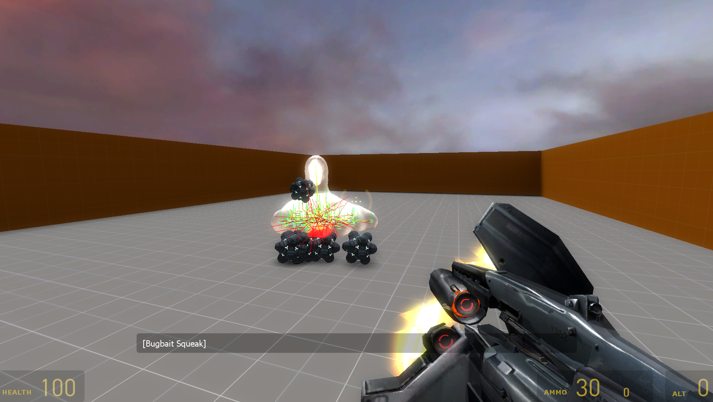

# READ THIS FIRST
Guess what: The episode 3 codebase leaked. 

[Join the Discord](https://discord.gg/y6c5G9HBbF)

## Features
* All episode 3 code
* Most code working
* All discovered episode 3 assets (not many)
* This code also works as a HL2 port to Alien Swarm 

> [!IMPORTANT]
> You no longer need Source Filmmaker or the `valve_asw_content` 7z. The setup process no longer depends on them, and can automatically make Alien Swarm compatible assets.
## Running
1. Install Python, Alien Swarm and Source SDK Base 2013 Singleplayer
2. Download this project to some place on your hard drive (preferably use the git clone command, it is easier to update as all you need is to git pull it)
3. Run game/ep3/setup.bat, it should install everything needed (make sure there is no errors in the log though). It ensures Alien Swarm and SDK 2013 are installed, extracts the data, modifies the models, deletes and changes some old format data, and ports everything over to formats Alien Swarm, Portal 2 and CSGO engines understand. If there is a major error and the setup fails, delete valve_assets_converted, fix the error and re-run the batch file.
4. Optionally, copy over the HL2 pre-anniversary maps from the steam-legacy branch of HL2.
5. If you have not installed Alien Swarm to C:\Program Files (x86)\Steam\steamapps\common\Alien Swarm\, modify run_client.bat and gameinfo.txt to point to the correct directory
6. Run the game via run_client.bat

## Guide to usage
To start, load the first map in chapter select, ep3_testroom.

### Special suit abilities
The icegun and teleport gun are both special suit abilities. This means you can select them in weapon select like normal weapons, but you use them with other weapons at the same time. To use these weapons, hold left ALT to fire.
For example: Select the shotgun, then select the icegun, and you can shoot the shotgun with left click, but holding ALT activates the icegun.

### Weaponizer
Weaponizer absorbs objects with ALT, and then shoots them back out with left click.

### Flamethrower
The flamethrower shoots fire with left click, and shoots fuel (that can then be ignited) with right click.

### Tau Cannon and Gauss Gun
These behave like their versions in Half Life Source.

## Reporting bugs
Report bugs on this github repo under issues, or add them in the discord.

## Building
1. Install Visual Studio 2013 (This is required even if you have a newer version of VS installed)
2. Go to src/ and run creategameprojects2013.bat
3. Click on Game_EP3-2013.sln
4. Change Debug to Release up the top
5. Build it from source

## TODO
* Make Test maps - join discord
* Remake models and assets
* Remake particles
* Research weaponizer
* Research blob
* Fix map
* Fix gravity gun - why is it behaving so weirdly
* Fix a lot of things
* Finish fixing hl2 support

## Credits
* GaijinViking - Discovering the Episode 3 ice texture exists in Dota 2, and helping me find code to decompile.
* Klaxon - For the blobulator headers
* Wonderland War - For getting a recreation of the Episode 3 Weaponizer model made
* Valve - For making a great game, even if they did abandon it.
* OddDoc - Physics parameter file (that was a pain to work out, good thing he remade it) and blob materials
* Steryo Yamada - Tutorial map and title fixes
* Infecation - Explained mat_queue_mode 0 can fix a crash with the blob.