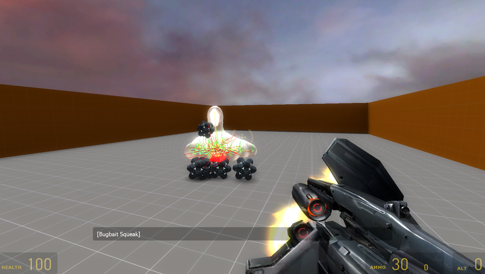

# READ THIS FIRST
Guess what: The episode 3 codebase leaked. 
[Join discord to help contribute](https://discord.gg/r5zAV6wCm)

## Features
* All episode 3 code
* Most things working (but not all, I only has 2 hours to make all this today!)
* All discovered episode 3 assets (not many)
* This code also works as a HL2 port to Alien Swarm 

## Running
1. Install Alien Swarm
2. Download this project to some place on your hard drive (use git clone etc)
3. Download and extract valve_asw_content.7z into a folder (NOT the project folder) from (it has the hl2, ep1, and ep2 content ported to Alien Swarm, but no maps. You can officially find these assets on steam in the free app source filmmaker, but it is easier to install this way) this [link](https://drive.google.com/file/d/1GSNoyJJHDbT-nVyJYj2p91OIsnEnaxKn/view?usp=sharing)
4. Replace "E:\valve_asw_content\*" in (wherever you installed this project)/game/ep3/gameinfo.txt with the path of wherever you extracted all the assets
5. If you have not installed Alien Swarm to C:\Program Files (x86)\Steam\steamapps\common\Alien Swarm\, modify run_client.bat and gameinfo.txt to point to the correct directory
6. Run the game via run_client.bat

## Building
1. Install Visual Studio 2013 (This is required even if you have a newer version of VS installed)
2. Go to src/ and run creategameprojects2013.bat
3. Click on Game_EP3-2013.sln
4. Change Debug to Release up the top
5. Build it from source

## TODO
* Make Test maps - join discord
* Fix blob rendering
* Improve icegun stability
* Remake models and assets

## Credits
* GaijinViking - Discovering the Episode 3 ice texture exists in Dota 2, and helping me find code to decompile.
* Klaxon - For the blobulator headers
* Wonderland War - For getting a recreation of the Episode 3 Weaponizer model made
* Valve - For making a great game, even if they did abandon it.
* OddDoc - Physics parameter file (that was a pain to work out, good thing he remade it) and blob materials